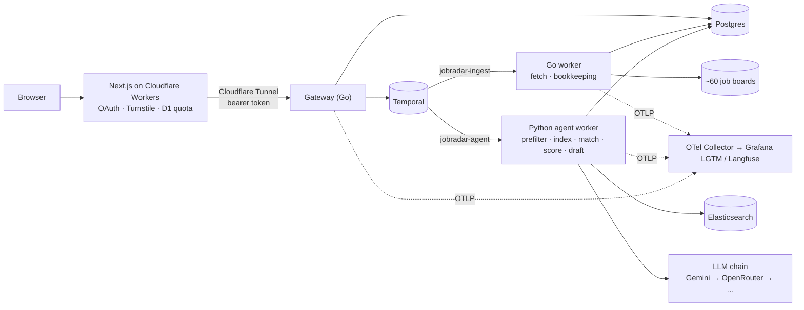
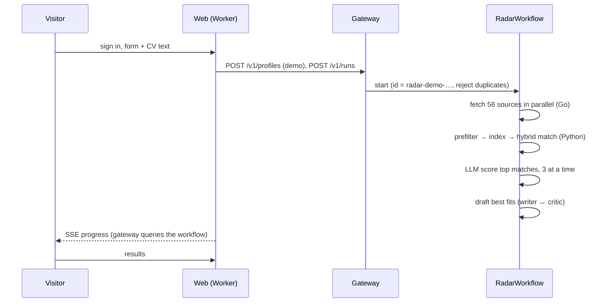

# JobRadar

[](https://github.com/Mrwanawad/JobRadar-Agentic-Job-Search-using-Go-Temporal-LangGraph-Elasticsearch-NextJS/actions/workflows/ci.yml)


Agentic job search platform. JobRadar pulls thousands of live postings from ~60 job boards,
ranks them against a CV with hybrid search, has an LLM agent explain every fit, and drafts
applications that a human approves before anything is sent.

- **Durable pipeline.** Every run is a Temporal workflow: retries, timeouts, live progress
  queries and approval signals come from the workflow engine, not hand-written glue.
- **Polyglot workers.** Go handles I/O-heavy ingestion (9 board parsers, bounded fan-out);
  Python runs the agents and search. One protobuf contract (`proto/`) types both sides.
- **Agents that check themselves.** A LangGraph screening graph repairs invalid JSON; a
  writer/critic graph rejects drafts that invent facts not in the CV.
- **Hybrid matching.** BM25 + local embeddings in Elasticsearch, fused with Reciprocal Rank
  Fusion. Embeddings run on CPU, so a CV is never sent to an embedding API.
- **Built for a free tier.** LLM calls go through a multi-key, multi-provider fallback chain;
  quota exhaustion stops scoring cleanly instead of failing the run.
- **Observable.** OpenTelemetry traces from gateway to LLM call, in Grafana (LGTM) and,
  for agent spans, Langfuse.

## Architecture



One run, end to end:



Details: [docs/ARCHITECTURE.md](docs/ARCHITECTURE.md) · [docs/WORKFLOWS.md](docs/WORKFLOWS.md)

## Repository

| Path | What |
|---|---|
| `orchestrator/` | Go: Temporal workflows, ingestion worker, HTTP gateway, migrations, schedules |
| `jobradar/agent/` | Python agent worker: LangGraph graphs, Elasticsearch search, Temporal activities |
| `jobradar/` | v0.1 single-machine CLI (fetch, score, draft, send) that the platform grew from |
| `jobradar/mcp_server.py` | MCP server: run, search and approve from Claude or any MCP client |
| `proto/` | Protobuf contract shared by Go and Python (`buf generate`) |
| `apps/web/` | Next.js 16 demo site for Cloudflare Workers ([README](apps/web/README.md)) |
| `deploy/` | Docker Compose stack, Dockerfiles, Cloudflare Tunnel config |
| `evals/` | Labeled postings + persona, prefilter and LLM screening evals |
| `docs/` | Architecture, workflows, runbook, security, decision records |

## Quickstart (local, Docker)

Needs Docker with ~6 GB RAM free and at least one free LLM key (Gemini or OpenRouter).

```bash
cp .env.example .env                      # fill GEMINI_API_KEY_1 and/or OPENROUTER_API_KEY
docker compose -f deploy/compose/compose.yaml up -d --build
curl localhost:8080/healthz               # ok
```

| Service | URL |
|---|---|
| Gateway API | http://localhost:8080 |
| Temporal UI | http://localhost:8233 |
| Grafana (traces, metrics, logs) | http://localhost:3000 |
| Elasticsearch | http://localhost:9200 |

Start a demo run against the API directly (token is `GATEWAY_TOKEN`, default `dev-token-change-me`):

```bash
H='Authorization: Bearer dev-token-change-me'
curl -s -H "$H" localhost:8080/v1/profiles -d '{
  "kind": "demo", "owner": "local:me",
  "profile": {"base": "Cairo, Egypt", "target_titles": ["AI Engineer"], "skills": ["python", "llm"]},
  "cv_text": "<paste 200+ characters of CV text>"}'
# -> {"id": "demo-…"}
curl -s -H "$H" localhost:8080/v1/runs -d '{"profile_id": "demo-…"}'
curl -N -H "$H" localhost:8080/v1/runs/radar-demo-…/events      # live progress (SSE)
curl -s -H "$H" localhost:8080/v1/profiles/demo-…/results       # ranked jobs + drafts
```

Then the web app: see [apps/web/README.md](apps/web/README.md).

## MCP server

Drive JobRadar from Claude Code, Claude Desktop or any MCP client. The server is a thin
client over the gateway API, so it gets the gateway's checks too (demo drafts can never be
approved, duplicate runs return 409).

| Tool | What it does |
|---|---|
| `start_run(profile_id)` | Start a radar run, returns `workflow_id` |
| `get_run(workflow_id)` | Status and live progress |
| `get_summary(profile_id)` | Pipeline counts and recent runs |
| `search_jobs(profile_id, query, min_score, limit)` | Scored jobs with reasons and red flags |
| `get_outbox(profile_id, status)` | Drafted applications with full text |
| `approve_draft(profile_id, outbox_id, approve, workflow_id, edited_body)` | Approve or reject a draft (signals the open run) |

```bash
claude mcp add jobradar -e GATEWAY_TOKEN=dev-token-change-me --   uv run --directory /path/to/repo --extra mcp jobradar-mcp
```

Read-only tools carry `readOnlyHint`; the server instructions tell the model to get the
user's explicit yes before approving a draft.

## Tests

```bash
uv run pytest                                  # Python: parsers, prefilter, graphs, activities
(cd orchestrator && go test -race ./...)       # Go: parsers (parity with Python), workflow tests on the Temporal test env
(cd apps/web && npm run lint && npm run typecheck)
```

CI runs all of these (including the prefilter quality gate on the labeled eval set) plus `buf lint`, a full Cloudflare Worker build and a gitleaks scan of
the whole git history.

## Docs

- [Architecture](docs/ARCHITECTURE.md): components, data model, why each piece exists
- [Workflows](docs/WORKFLOWS.md): RadarWorkflow, approvals, purge, schedules, limits
- [Runbook](docs/RUNBOOK.md): run, debug and recover the stack
- [Evals](docs/EVALS.md): labeled postings, prefilter CI gate, LLM screening eval
- [Security](docs/SECURITY.md): trust boundaries, secrets, data retention
- [Decision records](docs/adr/): Temporal, Go + Python split, client-side RRF, Workers + Tunnel
- [Sources](docs/ENDPOINTS.md): verified job-board endpoints and LLM free-tier limits
- [Changelog](CHANGELOG.md)

## Personal mode (v0.1 CLI)

The original single-user pipeline still works without Docker and runs the author's daily
search: `uv run jobradar run`, `draft`, `outbox`, with daily caps and a dry-run period before
anything is sent. See `uv run jobradar --help` and `profile.example.yaml`.

## Status

Backend and web app work end to end locally. Not yet deployed. Next: deployment to Oracle Cloud (k3s, Helm, Argo CD) behind Cloudflare.

## License

MIT
