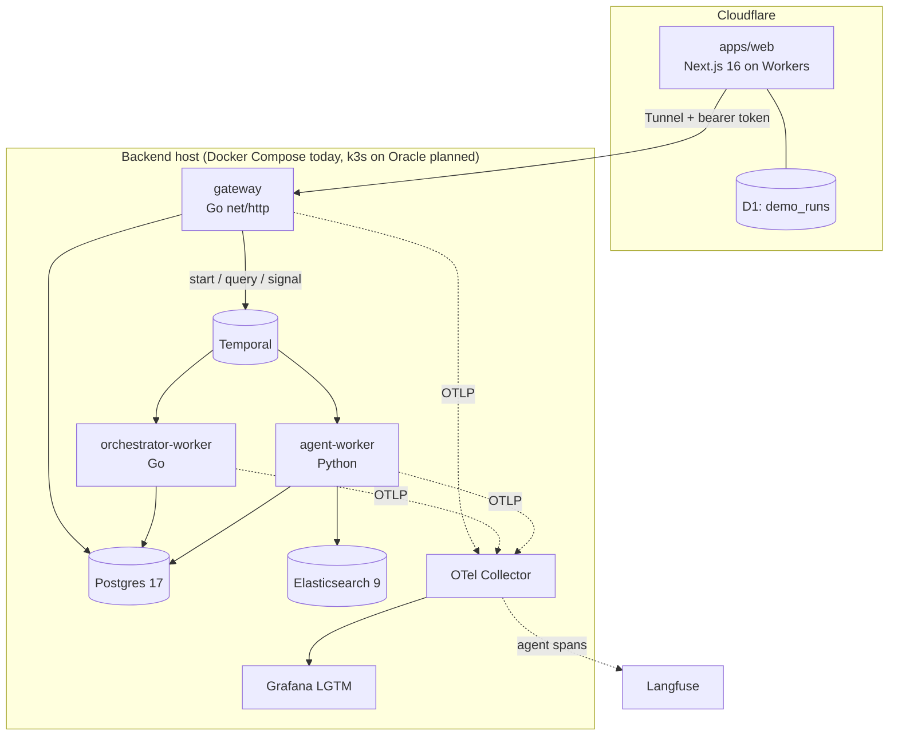

# Architecture

JobRadar turns "find me the right jobs" into one durable workflow per profile. This page
covers the components, the data they own, and why each one exists.

## Components



| Component | Language | Owns | Why it exists |
|---|---|---|---|
| `apps/web` | TypeScript | sign-in, bot check, demo quota per account | Public face; keeps the gateway token off the browser |
| gateway (`orchestrator/internal/gateway`) | Go | HTTP API, demo quota per owner hash | Single entry point to Temporal and Postgres |
| orchestrator-worker | Go | `jobradar-ingest` task queue: workflows, fetch, bookkeeping | Many concurrent HTTP fetches; cheap goroutines |
| agent-worker (`jobradar/agent`) | Python | `jobradar-agent` task queue: prefilter, index, match, score, draft | LangGraph, fastembed and the v0.1 rules live in Python |
| MCP server (`jobradar/mcp_server.py`) | Python | nothing (gateway client) | Lets Claude or any MCP client start runs, search results and approve drafts |
| Temporal | | workflow state, timers, retries, schedules | Durable execution; see [ADR 0001](adr/0001-temporal-for-orchestration.md) |
| Postgres | | jobs, profiles, runs, matches, outbox | Source of truth |
| Elasticsearch | | `jobs-v1` index (BM25 fields + 384-d vector) | Hybrid retrieval |
| OTel Collector, LGTM, Langfuse | | traces, metrics, logs | One trace from HTTP request to LLM call |

## Contract

`proto/jobradar/v1/radar.proto` defines every workflow and activity input/output. `buf
generate` writes Go types (`orchestrator/gen`) and Python types (`jobradar/v1`). Activities are
called across languages by name (`ActScoreJob = "ScoreJob"` and so on) with protobuf
payloads, so a field rename breaks the build on both sides instead of at runtime.

## Data model (Postgres)

| Table | Key | Notes |
|---|---|---|
| `jobs` | `uid` (fingerprint) | One row per posting across all sources; cross-posts collapse on fingerprint |
| `profiles` | `id` | `kind` personal or demo, profile JSON, CV text, `expires_at` for demos |
| `runs` | workflow id | status and final progress (protojson) per run |
| `matches` | (profile, job) | prefilter status, LLM score, assessment JSON |
| `outbox` | id | drafted applications: channel, subject, body, status |
| `source_fetches` | | per-source fetch log |
| `demo_quota` | sha256(owner) | one demo per account, without storing the account id |

`runs`, `matches` and `outbox` cascade on profile delete, so the purge workflow removes a
demo visitor's data with one `DELETE FROM profiles`.

## Matching

1. **Prefilter** (free): title include/exclude regexes, seniority, remote region and on-site
   city rules from the profile, posting age. Demo profiles are built from the web form by
   `jobradar/agent/profiles.py::demo_profile`.
2. **Index**: only this profile's unindexed candidates are embedded (fastembed,
   `BAAI/bge-small-en-v1.5`, ONNX on CPU) and indexed with their text fields.
3. **Hybrid search**: one BM25 query and one kNN query with the CV, fused client side with
   Reciprocal Rank Fusion (k = 60). See [ADR 0003](adr/0003-client-side-rrf.md).
4. **Screening agent** reads the top matches and returns a typed `Assessment`: score, role
   fit, seniority fit, location fit, visa sponsorship, reasons, red flags, pitch angle.

## Agents (LangGraph)

```
Screening   assess -> validate -+-> calibrate -> END
                     ^          |
                     +-- repair -+   invalid JSON or schema, at most MAX_REPAIRS times

Writing     draft -> critique -+-> finalize -> END
                     ^         |
                     +- revise -+   critic found fabrications or a weak draft, at most MAX_REVISIONS times
```

The critic compares the draft with the CV and lists fabrications. A draft passes only with no
fabrications and a score of at least `PASS_SCORE`; if every revision still fabricates, the
activity raises `DraftRejected` and nothing is stored.

The LLM is injected into both graphs, so tests drive them with scripted replies.

## LLM access

`jobradar/llm.py` is an OpenAI-compatible client over a provider chain set by
`LLM_PROVIDERS` (Gemini, OpenRouter, Groq, Mistral, Cerebras), with several numbered keys per
provider. A rate limit or bad key moves to the next key or provider. When every provider is
out of free quota the activity raises `QuotaExhausted`, a non-retryable error type that makes
the workflow stop scoring and finish with what it has.

Activities that wait on slow LLM calls heartbeat from a side thread, so Temporal can tell a
slow call from a dead worker.

## Web edge

`apps/web` runs on Cloudflare Workers through the OpenNext adapter. It owns sign-in (GitHub
and Google OAuth via `arctic`, HS256 session cookie via `jose`), the Turnstile bot check and
a D1 table mapping each account to its single demo run. It calls the gateway over a
Cloudflare Tunnel with the gateway bearer token and relays the run's Server-Sent Events to
the browser. See [ADR 0004](adr/0004-cloudflare-workers-and-tunnel.md).

## Observability

Every service exports OTLP to the collector. Traces go to Grafana Tempo (LGTM bundle);
agent-worker traces also go to Langfuse when `LANGFUSE_AUTH` is set. Each LLM call is an
OpenTelemetry GenAI span (`jobradar.llm`) and each graph node a child span, so one trace
shows the whole decision path for a job.
