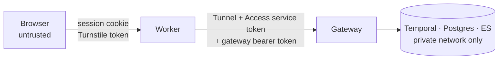

# Security

## Trust boundaries

- **Browser to Worker.** Every API route checks the signed session cookie (HS256,
  `SESSION_SECRET`, 7 days, `HttpOnly`, `SameSite=Lax`, `Secure` in production). Starting a
  run also needs a valid Turnstile token, verified server side. A visitor can only read the
  progress and results of the run recorded against their own account in D1.
- **Worker to gateway.** The gateway is never exposed directly. It is reached through a
  Cloudflare Tunnel; the tunnel hostname is meant to sit behind a Cloudflare Access
  service-token policy, and the gateway also requires its own bearer token (compared in
  constant time). Only the Worker holds either credential.
- **Gateway to internals.** Temporal, Postgres and Elasticsearch listen on the private
  network only. The compose file publishes their ports for local development; a production
  deployment must not.

## Abuse limits

| Limit | Enforced by |
|---|---|
| One demo run per account | D1 `demo_runs` (Worker) and `demo_quota` (gateway); a duplicate workflow start is rejected by Temporal |
| Demo run size: 10 scored, 3 drafts, top 25 matches | Gateway `DemoLimits`, not caller input |
| CV text 200-60,000 characters, request body ≤ 1 MiB | Worker (zod) and gateway |
| Form fields bounded (titles ≤ 6, skills ≤ 20, 60 chars each) | Worker (zod) and agent (`DemoForm`, pydantic) |
| Bots | Turnstile on run start; OAuth sign-in |

The demo form is turned into prefilter regexes with every user value escaped
(`re.escape`), so form input cannot inject patterns.

## Personal data

| Data | Where | Retention |
|---|---|---|
| CV PDF | Never leaves the browser (pdf.js extracts text client side) | n/a |
| CV text, form answers | Postgres `profiles` | Demo: deleted by the hourly purge 24 h after creation, with matches and drafts (cascade) |
| Account id (`github:<id>` / `google:`) | D1 `demo_runs` | Kept, to enforce one run per account |
| Account id hash | Postgres `demo_quota` (sha256) | Kept, to enforce one run per account |
| Name, avatar URL | Session cookie only | Until sign-out or 7 days |
| CV embeddings | Computed locally (fastembed); no embedding API | Elasticsearch holds job vectors, not CV vectors |
| CV text in LLM prompts | Sent to the configured LLM provider for scoring and drafting | Provider's own policy |

OAuth requests only basic profile scopes (`openid profile email` for Google, none for
GitHub). No OAuth tokens are stored.

Demo runs never send anything: outreach sending exists only in the personal CLI, behind a
dry-run date, daily caps and per-recipient deduplication.

## Secrets

- Worker: `wrangler secret put` (`SESSION_SECRET`, `GATEWAY_TOKEN`, OAuth secrets,
  `TURNSTILE_SECRET_KEY`, Access service token). Local values live in `.dev.vars`
  (gitignored); only `.dev.vars.example` is committed.
- Backend: `.env` (gitignored), passed to containers by compose. `GATEWAY_TOKEN` defaults to
  `dev-token-change-me` for local use only.
- CI runs gitleaks over the full git history on every push.

## Reporting

Please report vulnerabilities privately through GitHub's *Report a vulnerability* (Security
tab) rather than a public issue.
