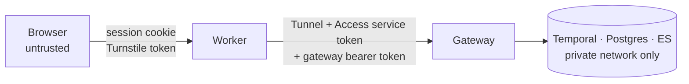

# Security

## Trust boundaries

- **Browser to Worker.** Every API route checks the signed session cookie (HS256,
  `SESSION_SECRET`, 7 days, `HttpOnly`, `SameSite=Lax`, `Secure` in production). Starting a
  run also needs a valid Turnstile token, verified server side. A visitor can only read the
  progress and results of the run recorded against their own account in D1.
- **Worker to gateway.** The gateway is never exposed directly. It is reached through a
  Cloudflare Tunnel; the tunnel hostname is meant to sit behind a Cloudflare Access
  service-token policy, and the gateway also requires its own bearer token (compared in
  constant time). Only the Worker holds either credential.
- **Gateway to internals.** Temporal, Postgres and Elasticsearch listen on the private
  network only. The compose file publishes their ports for local development; a production
  deployment must not.

## Abuse limits

| Limit | Enforced by |
|---|---|
| One demo run per account | D1 `demo_runs` (Worker) and `demo_quota` (gateway); a duplicate workflow start is rejected by Temporal |
| Demo run size: 10 scored, 3 drafts, top 25 matches | Gateway `DemoLimits`, not caller input |
| CV text 200-60,000 characters, request body ≤ 1 MiB | Worker (zod) and gateway |
| Form fields bounded (titles ≤ 6, skills ≤ 20, 60 chars each) | Worker (zod) and agent (`DemoForm`, pydantic) |
| Bots | Turnstile on run start; OAuth sign-in |

The demo form is turned into prefilter regexes with every user value escaped
(`re.escape`), so form input cannot inject patterns.

## Personal data

| Data | Where | Retention |
|---|---|---|
| CV PDF | Never leaves the browser (pdf.js extracts text client side) | n/a |
| CV text, form answers | Postgres `profiles` | Demo: deleted by the hourly purge 24 h after creation, with matches and drafts (cascade) |
| Account id (`github:<id>` / `google:`) | D1 `demo_runs` | Kept, to enforce one run per account |
| Account id hash | Postgres `demo_quota` (sha256) | Kept, to enforce one run per account |
| Name, avatar URL | Session cookie only | Until sign-out or 7 days |
| CV embeddings | Computed locally (fastembed); no embedding API | Elasticsearch holds job vectors, not CV vectors |
| CV text in LLM prompts | Sent to the configured LLM provider for scoring and drafting | Provider's own policy |

OAuth requests only basic profile scopes (`openid profile email` for Google, none for
GitHub). No OAuth tokens are stored.

Demo runs never send anything: outreach sending exists only in lite mode, behind a
dry-run date, daily caps and per-recipient deduplication.

## Applier agent guardrails (lite mode + plugin)

Attacks on the agent itself (prompt injection in postings and careers pages, recipient
hijack, tool misuse) are covered in [THREAT_MODEL.md](THREAT_MODEL.md).

The Claude Code plugin acts in the user's own browser session. Its limits are enforced by the
CLI and by a PreToolUse hook outside the model; the skills state the rest:

- **Applier guard hook (enforced, `plugin/hooks/hooks.json` -> `jobradar/guard/hook.py`).**
  Runs before every Claude in Chrome `navigate`, `file_upload`, `javascript_tool`,
  `form_input`, `computer` and `browser_batch` call. Uploads: only the CV (and
  `out/cover_letters/`). Navigation: http(s) only, never local or private addresses; job
  boards, ATS hosts and companies in the job list pass, anything else asks the user.
  JavaScript: no network calls, cookies, storage, form-action rewrites, navigation or `eval`.
  Typing: never a `.env` secret or key-shaped string; private answers (salary, ID, birth date,
  address) ask first. It never auto-approves, a crash blocks the call, and every decision is
  logged to `data/guard_audit.jsonl` with typed values redacted (`jobradar guard audit`).
  Users can loosen it in `profile.yaml` under `guard:` (extra trusted sites, `unknown_sites:
  allow`, extra upload files, which answers to confirm, or `enabled: false`); the hard rules
  (`file:`/local addresses, secrets, JavaScript network and cookie access, uploads outside
  the allow list) do not change. `jobradar doctor` shows the settings and warns when the
  plugin hook is not installed or the guard is off.

- **No fabrication.** Form answers come from `profile.yaml` (`candidate`, `answers`) and the
  CV text only. Knockout questions get the truthful answer. Unknown required answers are asked.
- **No duplicates.** `jobradar check <company>` runs before every application; every submit is
  recorded with `jobradar mark` / `jobradar log`.
- **Human approval.** Each submit is confirmed by the user unless they waive it for that
  session. Emails go out only through `jobradar sendable`, which applies the dry-run date,
  the daily cap and per-recipient deduplication.
- **Recipient policy (enforced, `jobradar/guard/recipients.py`).** An email goes out
  automatically only when its domain belongs to the company (company name or the posting's
  own host, never an ATS or job board). Free-mail and mismatched addresses, every WhatsApp
  message (it carries the CV PDF) and postings with scam phrases are held as `review` until
  the user runs `jobradar approve <id>`; reserved domains are blocked. `sendable()` checks
  again at send time. In platform mode held drafts are stored as `review`, which the gateway
  and MCP `approve_draft` cannot approve.
- **Output policy (enforced, `jobradar/guard/output.py`).** Drafts may contain only the
  candidate's own links, email and phone, no private form answers, only numbers found in the
  CV or posting, no long spans copied from the posting, and plain text. A violating draft
  gets one revision, then is rejected.
- **Hand-back, never bypass.** CAPTCHAs, logins, account creation, payment or ID requests and
  "do not use AI" essays stop the job and leave the tab to the user. The agent never types
  passwords or payment details.
- **No LinkedIn automation.** LinkedIn's terms forbid it; the plugin does not touch it.
- **Local dashboard.** Binds to 127.0.0.1 only, answers only requests whose `Host` is
  `127.0.0.1`, `localhost` or `[::1]` (stops DNS rebinding from other websites), and renders
  links only for http(s) URLs.
- **Local data.** Profile, CV, database and logs stay on the user's machine (gitignored, or
  under `JOBRADAR_HOME`). CV text goes only to the LLM provider the user configured.

## Secrets

- Worker: `wrangler secret put` (`SESSION_SECRET`, `GATEWAY_TOKEN`, OAuth secrets,
  `TURNSTILE_SECRET_KEY`, Access service token). Local values live in `.dev.vars`
  (gitignored); only `.dev.vars.example` is committed.
- Backend: `.env` (gitignored), passed to containers by compose. `GATEWAY_TOKEN` defaults to
  `dev-token-change-me` for local use only.
- CI runs gitleaks over the full git history on every push.

## Reporting

Please report vulnerabilities privately through GitHub's *Report a vulnerability* (Security
tab) rather than a public issue.
