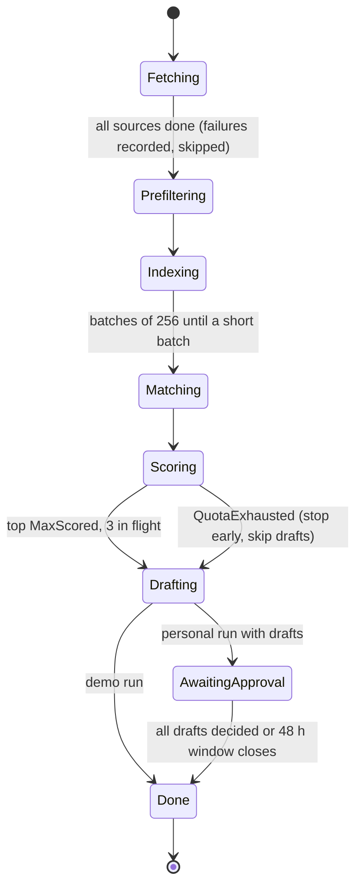

# Workflows

Code: `orchestrator/internal/workflows`. Workflows are deterministic orchestration only;
every side effect is an activity on one of two task queues:

| Queue | Worker | Activities |
|---|---|---|
| `jobradar-ingest` | Go | `FetchSource`, `RecordRunStart`, `RecordRunFinish`, `RecordDecision`, `PurgeExpired` |
| `jobradar-agent` | Python | `Prefilter`, `IndexJobs`, `MatchJobs`, `ScoreJob`, `DraftApplication`, `TopJobs` |

## RadarWorkflow

One end-to-end run for one profile.

| Step | Activity options | Failure handling |
|---|---|---|
| Fetch | 3 min timeout, 3 attempts, backoff ×3, at most `FetchConcurrency` in flight | Error added to `progress.errors`; the run continues |
| Prefilter | 10 min, 3 attempts | Fails the run |
| Index | 15 min per batch, 5 attempts, up to 40 batches | Fails the run |
| Match | 5 min, 3 attempts | Fails the run |
| Score | 10 min, 4 attempts, 2 min heartbeat, 3 in flight | Per-job error recorded; `QuotaExhausted` stops scoring |
| Draft | 10 min, 3 attempts, 2 in flight, only scores ≥ `MinDraftScore` | Per-job error recorded |

Bookkeeping (`RecordRunFinish`) runs in a disconnected context, so the run row is closed
even if the pipeline failed or the workflow was cancelled.

### Limits

| Limit | Personal default | Demo |
|---|---|---|
| `FetchConcurrency` | 8 | 8 |
| `MatchTopK` | 40 | 25 |
| `MaxScored` | 25 | 10 |
| `MaxDrafts` | 8 | 3 |
| `MinDraftScore` | 7.5 | 7 |

Demo limits are set by the gateway (`gateway.DemoLimits`), never by the caller.

### Progress

The workflow keeps a `RadarProgress` message and answers the `progress` query with it. The
gateway serves `GET /v1/runs/{id}` from the query while the run is open and from the stored
final progress afterwards; `GET /v1/runs/{id}/events` polls it every 2 s and emits a
Server-Sent Event whenever it changes.

### Approvals (personal runs)

After drafting, a personal run waits on the `approval` signal (`ApprovalSignal{outbox_id,
approve, edited_body}`) until every draft is decided or `ApprovalWindow` (48 h) passes.
`POST /v1/outbox/{id}/decision` sends the signal while the run is open, or records the
decision directly once it has closed. Undecided drafts stay drafts. Demo runs never wait.

### Idempotency

Workflow ids are deterministic: `radar-<profile>` for a demo, `radar-<profile>-<YYYYMMDD-HHMM>`
for a personal run. Starts use `WORKFLOW_ID_REUSE_POLICY_REJECT_DUPLICATE` with
`WorkflowExecutionErrorWhenAlreadyStarted`, so a second start of a demo returns 409.

## PurgeWorkflow

Deletes profiles whose `expires_at` has passed (demo profiles live 24 h). Matches, outbox
rows and runs cascade. Runs hourly, so a visitor's CV text outlives its window by at most an
hour.

## Schedules

`jobradar schedule <personal-profile-id>` creates or replaces two Temporal Schedules:

| Schedule | Spec | Overlap |
|---|---|---|
| Daily radar for the owner's profile | cron `0 9 * * *` | skip |
| Purge | every hour | skip |

## Tests

`radar_test.go` runs the workflow in Temporal's test environment with mocked activities:
a full demo run, quota exhaustion stopping scoring without failing the run, a personal run
waiting for approvals, and the approval window closing.
